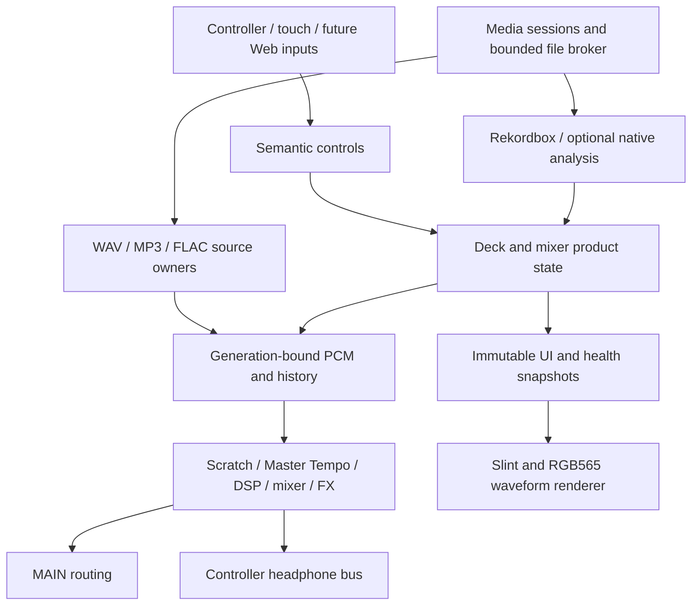

# Pajoniiir M1 architecture

Updated: 2026-10-21. Targets: Guition JC1060P470C_I_W_Y and JC8012P4A1C_I_W_Y.

## Product and platform

Native no_std Rust product logic is independent of esp-hal, board GPIOs and
physical transport. The host workspace supplies deterministic regressions and
the Slint desktop simulator. The separate P4 workspace owns HAL integration.
Pajoniiir M2.2 remains the functional reference; physical unit qualification is
separate from product-model and build evidence.

## Board resource ownership

Only the explicit Guition selector may acquire that board's resources. Idle
selectors start the scheduler; diagnostic variants additionally own native USB
Serial/JTAG and explicitly selected memory probes. There is no product owner
startup on either board yet.

`integration-check` compiles product-owner combinations with no board resource
acquisition, heap-region registration or task spawns. It is incompatible with a
Guition selector. Its compile results establish type/API compatibility, not a
bootable DJ integration or physical task lifecycle. Default features remain empty.

The controller owner accepts a BSP-prepared USB peripheral instance. SD profile
storage accepts an SD slot plus power/presence policy; no card-detect input or
polarity is invented. The Hot Cue owner requires an explicit validated flash
layout, verifies actual partition entries and rejects overlap before opening
the journal. No persistent address or board programming layout is selected.

## Product and controller lifecycle

`pajoniiir-core`, controller core/profile/session/USB crates, deck and mixer
modules separate semantic controls from device descriptor/profile bindings.
Controller replacement/reconnect invalidates generation-bound held state and
reconciles only replayable absolute state. Product ownership remains authoritative
when source, control and persistence queues are temporarily busy.

Hot Cue journaling uses a versioned record format, bounded transfer/queues and
fault containment. A faulted store cannot acknowledge an unconfirmed durable
write, and persistent failures must not block other transport/control work.
General settings storage and signed OTA are separate, unfinished subsystems.

## Media and analysis

FAT32/exFAT and USB media modules use lease/generation-bound clients and bounded
requests. Catalog publication is transactional and immutable; detach/load
replacement fences stale source, analysis and catalog completions.
Rekordbox PDB/DAT/optional EXT analysis feeds neutral waveform, beatgrid and cue
consumers. Missing EXT does not invalidate a usable DAT; malformed partial
analysis is not published.

The optional APTA adapter owns bounded worker banks, retained/recycled delivery
and stopped-deck arbitration. It cannot replace already accepted analysis or
publish against a stale media/load generation. Native analysis is cancelled
during playback. Default/simulator dependency graphs exclude it, and it is not
activated on Guition. The original APTA branch remains unmerged.

## Audio and UI

WAV/MP3/FLAC decoding shares bounded source/read/block/control contracts. Canonical
PCM/history is generation-scoped; scratch and Master Tempo arbitrate source
progression, loop wraps and output confirmations. The render path applies DSP,
mixer/FX and separate MAIN/PFL processing. Filesystem/network/OTA/parsing and
unbounded allocation stay outside its deadline path.

MAIN prefers a ready external stereo DAC, then compatible controller MAIN,
otherwise mute. Headphones always use controller UAC channels independently of
MAIN. MIDI-only control does not establish headphone capability. Actual DAC
detection, channels, clocks, I2S/UAC pacing, latency and listening remain pending.

The desktop simulator composes shared product state and waveform rasterization
into Slint. It has interactive decks, Library, Hot Cues, session settings,
mixer/FX and diagnostics. Captured analysis observations show their original
transition clock; a refresh does not imply current device liveness. UI goldens
cover both documented geometries; no device framebuffer/touch driver is active.

## Memory, display and service

Board profiles retain documented capacities separately from actual observations.
The optional flash probe uses read-only RDID with bounded polling and reports
unknown/timeout rather than substituting a profile capacity. The release-only
PSRAM probe autodetects at 80 MHz and touches a reserved 64 KiB CPU-cached span,
without adding an allocator. It does not qualify cache/DMA or full-array memory.

Panel/touch adapters are HAL-independent, inactive contracts with explicit unit,
source and wiring evidence. Panel startup keeps the backlight off until reset,
external commands and scanout complete. Failed cleanup blocks restart. Touch
activation separately validates controller/address/pins/coordinate policy and
external payload requirements. The shared I2C bus needs one owner. No panel table
or GSL3680 firmware is bundled.

Boot reports are immutable snapshots. Runtime publications, when integrated,
have independent generation/freshness contracts and bounded observers. Repeating
a boot report or reading unchanged analysis state does not refresh its timestamp.
Logs, health labels and matching package identities never establish physical
readiness or the exact bytes programmed into a unit.

See [board contracts](boards/GUITION_HARDWARE_MATRIX_2026-10-20.md),
[first boot](boards/GUITION_FIRST_BOOT_2026-10-20.md), [development](DEVELOPMENT.md),
[requirements](M1_RUST_PRODUCT_REQUIREMENTS.md) and [ADRs](adr/).
